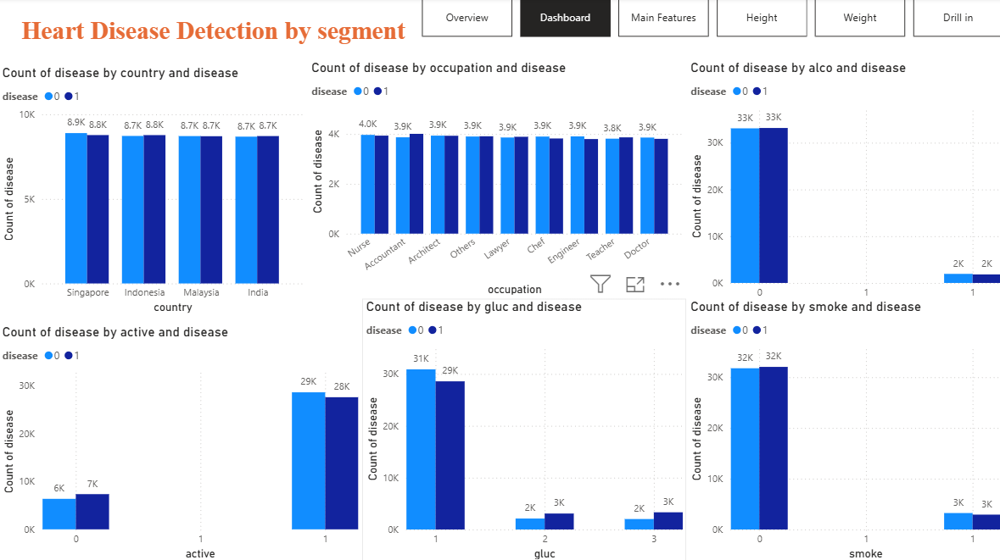
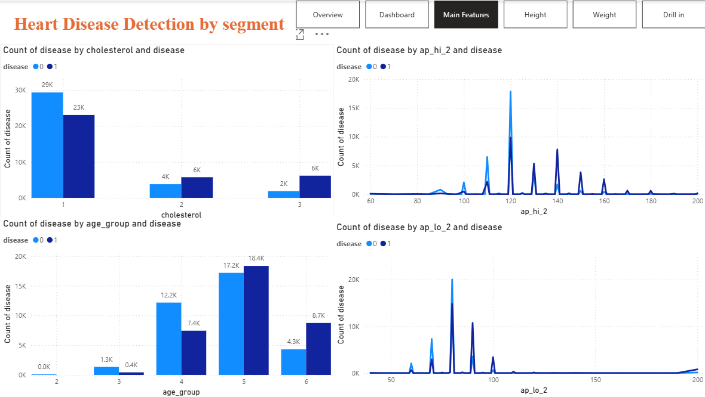

# Heart_disease_detection
Heart disease detection - Predictive Analytics

## Problem statement
Heart disease is a leading cause of mortality worldwide. **Early detection** and **accurate** prediction of heart disease can significantly improve patient outcomes by enabling **timely intervention** and **preventive measures**. The objective of this project is to develop a machine learning model that can effectively predict the presence or absence of heart disease based on **various medical** and **lifestyle factors**.

## Data Information
• The dataset provided for this project is a subset of data our team worked on for a project of **Parkway Pantai** to understand the influence of various factors on the heart disease. \
• The data provided to you contains all the required detail to understand the impact on heart such as cholesterol level, blood pressure, alcohol consumption etc. \
• All the information about the features is present in Data_Dictionary.pdf

## Create models to predict heart disease.
+ Linear Logistic Regression
+ Linear Support Vector Machine
+ K Nearest Neighbours
+ Naive Bayes
+ Decision Tree
+ Random Forest

## General Observations
Heart Disease is number 1 cause of death worldwide.
By WHO, about 17.9 million deaths per year, contribute to some 32% of all deaths.
Some 80% of premature cardiovascular disease CVD cases are preventable.

## Insights
* 4 Main features:
  **age_group**, **ap_hi**, **ap_lo**, **cholesterol**.
  71% accuracy
+ Age group getting heart disease
\ '>= 30 - 24.3% \
'>= 40 - 38.0% \
'>= 50 - 51.6% \
'>= 60 - 67.0%
+ Blood Pressure heart disease when ap_hi > 130, ap_lo > 90
+ Cholesterol \
1 - 44% \
2 - 60.2% \
3 - 76.5%

+ Surprise that there is no significance of heart disease by country, occupation, gender, physical activity, alcohol consumption, glucose level, smoking. Maybe the dataset is old or not real.

## Warning Signs
+ Chest pain, pressure or tightness (angina)
+ Shortness of breath — at rest or with activity
+ Fatigue, dizziness or fainting
+ Swelling in legs, ankles or feet
+ Irregular or racing heartbeat
+ Pain radiating to jaw, neck, arm or back

## Prevention Checklist
✓  Eat a balanced diet — vegetables, whole grains, healthy fats; less salt & sugar \
✓  Exercise regularly — at least 150 min/week of moderate activity \
✓  Do not smoke; avoid secondhand smoke \
✓  Limit alcohol and maintain a healthy weight	\
✓  Control blood pressure, cholesterol & blood sugar \
✓  Take prescribed medications as directed \
✓  Get regular check-ups — especially with a family history \
✓  Manage stress; aim for 7–9 hours of sleep

As the behaviour of the data is consistent, could consider tweaking the dataset by oversampling and undersampling with insufficient data as the input data.

Connect with Me!
Like my work? Email me LimKianKok88@gmail.com
